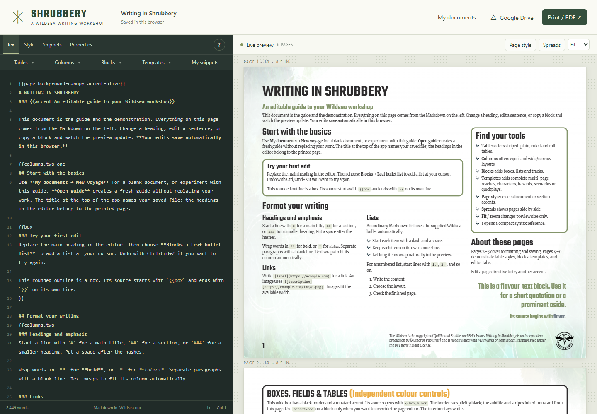
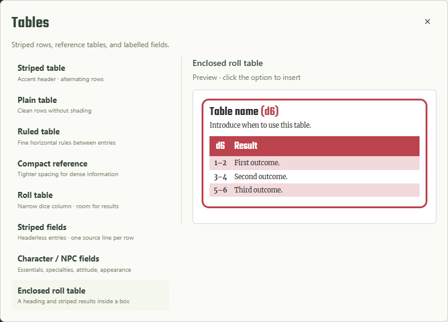
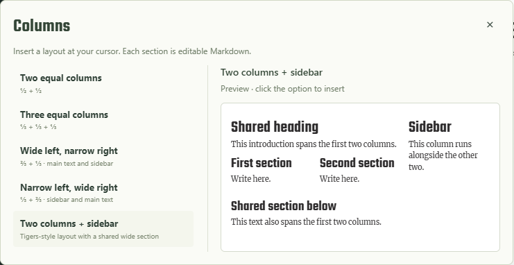
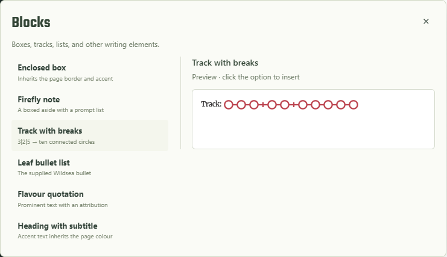
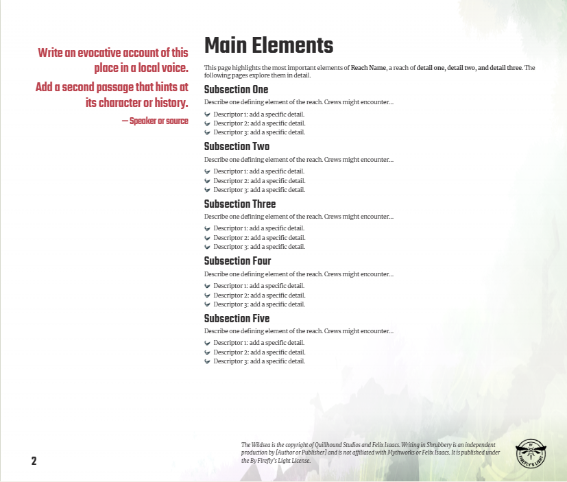
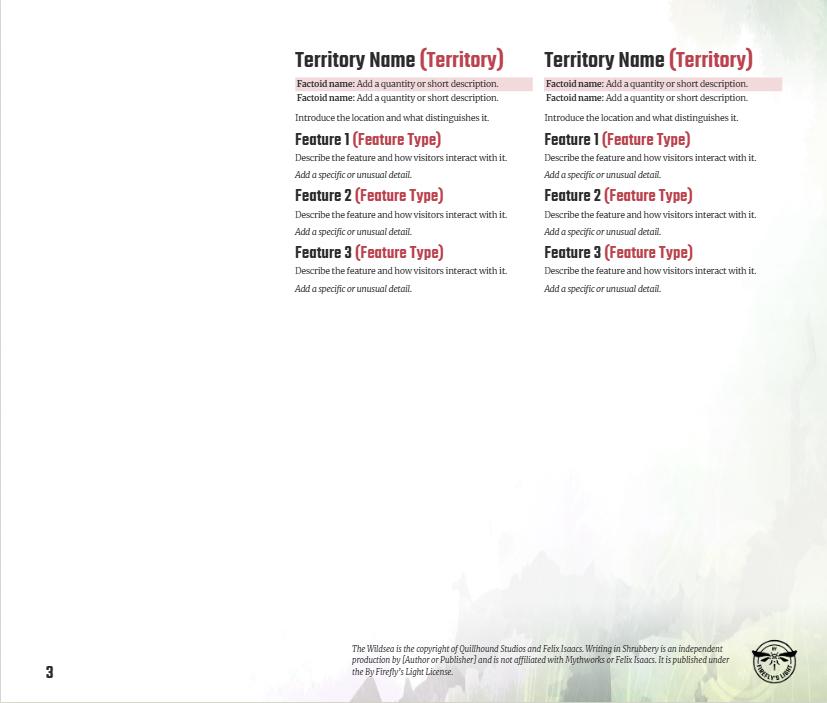

# The Shrubbery

A Markdown workshop for creating adventures, reaches, hazards, and character options for **The Wildsea**, published by **[Mythworks](https://www.myth.works/)**. Inspired by [Deltagreenery](https://github.com/Berlinia/deltagreenery) and [the Homebrewery](https://homebrewery.naturalcrit.com/), Shrubbery combines a text editor with a live book-style preview. Its layouts follow the Wildsea templates.

**[Open The Shrubbery](https://berlinia.github.io/theshrubbery/)** · [Deployment status](https://github.com/Berlinia/theshrubbery/actions/workflows/pages.yml)

## Wildsea rights and publishing license

Wildsea is published by Mythworks. Read the official [By Firefly’s Light license](https://www.wildwords-srd.com/firefly/legal) before publishing fan work. The repository’s MIT license covers its original source code; it does not grant ownership of Wildsea intellectual property, artwork, or third-party fonts. Asset provenance is recorded in [reference notes](docs/reference-notes.md), and vendored software notices are in [dist/vendor](dist/vendor/).

The Wildsea is the copyright of Quillhound Studios and Felix Isaacs. The Shrubbery is an independent production by Berlinia and is not affiliated with Mythworks or Felix Isaacs. It is published under the By Firefly’s Light License.

Every generated page includes the supplied template’s license notice and emblem. Set your document title and author in **Properties** so the footer identifies your work. Refer to the linked license for its full publication and attribution conditions.

## Using the editor

- **Text:** write Markdown with a live preview. Hover or keyboard-focus Tables, Columns, and Blocks options to preview them; click to insert.
- **Style:** edit document CSS using selectors such as `.sheet h1`, `.page-content`, and `.box`. Rules are scoped to the preview. Regular rules, `@media`, and `@supports` are supported.
- **Snippets:** define reusable Markdown blocks starting with `\snippet Name`. Select a snippet’s button to insert it at your text cursor.
- **Properties:** edit title, author, description, tags, language, default background, accent, and first page number.

Open **?** for syntax help, or **My documents → Open guide** for an editable walkthrough. Templates insert full sets of pages while preserving existing content:

| Template | Pages | Contents |
| --- | ---: | --- |
| Reach | 10 | Main Elements, territories, ports, factions, resources, character element |
| Character element | 2 | Introduction, sixteen aspects, quickstart kit |
| Character aspects | 1 | Standalone aspects and quickstart kit |
| Hazard | 2 | Full hazard, hooks, encounters, compact alternatives |
| Quickplay | 2 | Three acts, pre-game checks, hazard reference |
| Scenario | 14 | Locations, locals, room generator, finale, campaign hooks, encounters, credits |

Templates begin with `header=true accent=red`. Change the header accent or use **Page style → Current section** to recolor the section through the next header. Covers also start sections; ordinary Markdown headings do not. Without a specified accent, the document default is black.

```text
{{page header=true accent=willow}}
# A new reach

\page
# Main Elements

{{box
### A useful detail
The box inherits the section accent.
}}

**Progress:** {{track 3|2|5}}
```

This track has ten connected circles, with breaks after circles three and five. Other tools include leaf bullets, striped tables and fields, outlined boxes, and two/three-column layouts. Page breaks are explicit: overflowing content does not automatically flow to another page. Warnings identify where to shorten text or add `\page`.

## See it in action

The source stays on the left while the pages update on the right. The built-in **six-page guide** is itself an editable document: change an example and see the result immediately.



### Tables: preview, insert, edit

Open **Tables** and hover over a choice. The preview uses the current page’s accent; click to insert its Markdown. Choose striped, plain, ruled, compact, or roll tables, labelled fields, or an enclosed table.



For a simple striped table, write:

```markdown
| d6 | Result |
|:---:|:---|
| 1–2 | First outcome. |
| 3–4 | Second outcome. |
| 5–6 | Third outcome. |
```

For labelled facts without column headings, use **Striped fields**:

```text
{{fields
**Essentials:** Name, bloodline, and role.
**Attitude:** How they respond to the crew.
**Appearance:** A memorable visual detail.
}}
```

### Columns: arrange the page

Choose equal columns, a wide section beside a narrow sidebar, or two columns sharing a heading beside a third sidebar. Hover to compare the arrangements before inserting.



This creates a wide left column and a narrow right column:

```text
{{columns,two-one
## Main section
Write your main text here.

\column

{{box
### Sidebar
A short supporting detail.
}}
}}
```

Change `two-one` to `one-two` to reverse the proportions. Use `two` or `three` for equal columns. Each `\column` starts the next column; close the inner box before closing the outer layout. Put a heading or box before the columns block to make it span the page.

### Blocks: combine boxes, lists, and tracks

Insert an enclosed box, Firefly note, leaf-bullet list, quotation, accented subtitle, or connected track. These can sit directly on a page or inside a column.



```text
{{box
### Progress {{accent (Three stages)}}
Explain what marks the track and what changes at each break.

{{track 3|2|5}}
}}
```

`3|2|5` means **ten circles**, with breaks after the third and fifth circles. The box and track inherit the page accent. Change the numbers to resize the groups; use `6` for one unbroken track.

### Templates: start with a complete structure

1. Create a blank document and choose **Templates → Reach**.
2. The editor inserts ten editable pages, starting with a cover. The first content page is **Main Elements**, with five subsections and encounter descriptors.
3. The next page contains two territories, each with factoids and three features. Later pages add ports, factions, and reference material.
4. Replace the prompts, delete sections you do not need, or copy them to add more. Choose **Page style → Current section** to change the whole reach’s accent.

| First content page: Main Elements | Next page: Territories |
| --- | --- |
|  |  |

These are screenshots of the actual inserted template. Selecting one adds the complete structure after your current page, or fills an empty page, without replacing existing writing. Each template starts a new red-accented section; edit `header=true accent=red` on its first page to choose another color.

### Learn by editing the guide

Choose **My documents → Open guide** for a fresh copy. Its six pages cover:

1. Markdown basics and the editor controls.
2. Boxes, striped fields, and standard tables.
3. Column layouts, colors, saving, printing, and tracks.
4. Plain, ruled, compact, and roll-table comparisons.
5. A wide box above three columns, with notes, lists, quotations, and tracks.
6. Choosing a template, setting section accents, using Style/Snippets/Properties, and exporting your work.

Try changing a table row, turning `two-one` into `one-two`, or editing a track’s groups. Your changes remain ordinary Markdown that you can download and reuse.

## Static website

The application runs in your browser. GitHub Pages serves only `dist/`; there is no application backend, database, site account, or document upload to the host. Relative asset paths work at the domain root or `/theshrubbery/` without a build step.

### Run locally

Install Node.js 20 or newer, then:

```sh
git clone https://github.com/Berlinia/theshrubbery.git
cd theshrubbery
npm start
```

Open **http://localhost:4173/**. Dependencies are vendored, so `npm install` is unnecessary. The local server binds to loopback and serves only `dist/`. Set `PORT` to change its port. Windows users can also use `start.bat`.

### Storage and sharing

Drafts save automatically in browser localStorage. Clearing site data removes those copies. Use **My documents → Download Markdown** for portable backups; importing restores text, CSS, snippets, and properties. Share downloaded Markdown or printed PDFs through your own storage.

Google Drive is optional. Connect your account, then explicitly save or open documents from the Drive menu. Files are ordinary Markdown; the picker lists files created by Shrubbery. Switching accounts creates a new file instead of overwriting the previous account’s file. Detected external edits require opening the latest version or saving another copy.

Access tokens stay in memory. Refreshing or token expiration requires reconnecting. Drafts retain file identifiers and version information for future saves, but no access token or client secret. Disconnect ends the local connection.

Localhost and GitHub Pages have separate browser storage: use Markdown export/import or Drive to transfer drafts. Repositories under `berlinia.github.io` share an origin, but Shrubbery uses its own storage keys and Drive namespace. Remote images and Google services contact their respective providers. There is no analytics integration.

### Google configuration

For Google Auth Platform branding, use these public application links:

- Home page: https://berlinia.github.io/theshrubbery/
- Privacy policy: https://berlinia.github.io/theshrubbery/privacy.html
- Terms of service: https://berlinia.github.io/theshrubbery/terms.html

Use a **new, dedicated Wildsea OAuth web client**; Deltagreenery’s identity is not reused. `dist/config.js` ships with an empty public client ID. Editing, downloading, and printing work without Google setup.

1. Create a Google Cloud project and enable the Google Drive API.
2. Configure the OAuth consent screen. If the app is in Testing, add the intended Google accounts as test users.
3. Create a **Web application** OAuth client. Add `http://localhost:4173` and `https://berlinia.github.io` as authorized JavaScript origins.
4. Enter its public client ID in the app’s Drive menu, or set `googleClientId` in `dist/config.js` and push to redeploy. A client ID is public; never supply a client secret.
5. Connect Google Drive, authorize your account, and save a document.

Origins contain no path: do not include `/theshrubbery/`. Using `127.0.0.1` or a different port requires another origin. The app uses Google Identity Services’ browser token flow with `drive.file`, without a backend callback.

See Google’s [token model](https://developers.google.com/identity/oauth2/web/guides/use-token-model) and [Drive authorization scopes](https://developers.google.com/workspace/drive/api/guides/api-specific-auth). Tests mock Google responses; live authorization requires your dedicated client and account consent.

### GitHub Pages

[Deploy public website](.github/workflows/pages.yml) runs on pushes to `main` and can be run manually. It runs the Node tests, uploads **only `dist/`**, and deploys to the `github-pages` environment. Documentation, tests, local screenshots, and the development server are excluded from the website artifact.

For a fork or a fresh setup:

1. In **Settings → Pages**, choose **GitHub Actions** as the source.
2. Ensure the **github-pages** environment permits deployment from `main`.
3. Push to `main`, or use **Actions → Deploy public website → Run workflow**.
4. Wait for a successful deployment; its output reports the website URL.

This repository’s address is **https://berlinia.github.io/theshrubbery/**. Subsequent pushes update it automatically. No extra deployment branch is needed: `dist/` is the maintained static app. See [GitHub’s Pages workflow documentation](https://docs.github.com/en/pages/getting-started-with-github-pages/using-custom-workflows-with-github-pages).

## Printing

Use **Print / PDF** with background graphics enabled, browser headers/footers disabled, and scale set to 100%. Wildsea pages are **10 × 8.5 inches**; Quickplay pages are **11 × 8.5 inches**. `{{page size=letter}}` selects Quickplay dimensions on that page. Resolve overflow warnings first. Preview zoom and spreads do not change PDF dimensions; output remains individual pages.

## Code structure and checks

- `dist/app.js`: editing, drafts, menus, preview, and Drive actions.
- `dist/workspace.js`: Style, Snippets, and Properties editors.
- `dist/renderer.js` and `dist/document.css`: Markdown layout and page styling.
- `dist/snippets.js`, `dist/templates.js`, `dist/snippetPreview.js`: insertion choices, full templates, and hover previews.
- `dist/documentFormat.js`: portable Markdown metadata.
- `dist/googleDrive.js`: browser OAuth and Drive requests.
- `docs/`: palette, template structure, and asset provenance.
- `tests/`: renderer, persistence, Drive mocks, and browser checks.

Run `npm test` for Node tests. Browser checks require Playwright, installed Microsoft Edge, and the local server:

```sh
node tests/browser.mjs
node tests/menus.mjs
node tests/workspace.mjs
node tests/previews.mjs
```

Set `PLAYWRIGHT_MODULE` to an installed Playwright module URL/path when it is not locally resolvable. Screenshots and PDFs are written under the ignored `tmp/` directory.

README screenshots can be refreshed with `node tests/readme-screenshots.mjs` while the local server is running.
